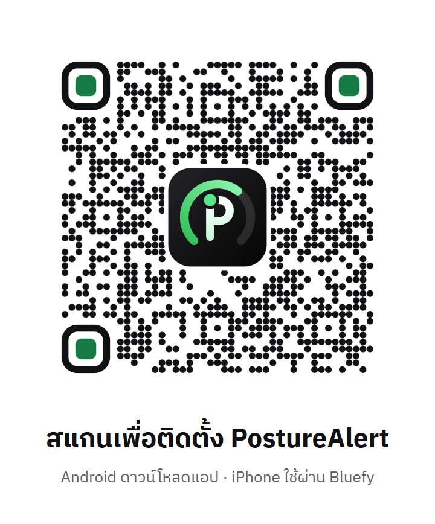

# PostureAlert

อุปกรณ์แจ้งเตือนหลังค่อม ติดเซนเซอร์ไว้ที่หลัง เมื่อหลังค่อมค้างนานเกินกำหนด อุปกรณ์จะสั่นเตือน และแสดงท่านั่งแบบสดบนมือถือผ่าน Bluetooth

- **เว็บแอป:** <https://matee202400129.github.io/posture-alert/>
- **หน้าติดตั้ง (Android / iPhone):** <https://matee202400129.github.io/posture-alert/install.html>



## ภาพรวมระบบ

```
 เซนเซอร์ MPU6050 ×2 ──I2C──▶ บอร์ด XIAO ESP32-C3 ──Bluetooth LE──▶ เว็บแอป / แอป Android
 (หลังบน + หลังล่าง)         อ่าน 20 ครั้ง/วินาที          ข้อมูลสถานะ 2 ครั้ง/วินาที ──▶
                             ตัดสินท่านั่ง + สั่นมอเตอร์    ◀── คำสั่ง เช่น บันทึกท่าตรง ตั้งเกณฑ์
```

| ส่วน | สร้างด้วย | โฟลเดอร์ |
| --- | --- | --- |
| เว็บแอป (PWA) | HTML, CSS, JavaScript ล้วน, Web Bluetooth | ไฟล์ที่ root, `js/`, `css/` |
| แอป Android | Java, WebView แสดงเว็บแอปชุดเดียวกัน, Foreground Service ถือ Bluetooth | `android/` |
| เฟิร์มแวร์ | C++ (Arduino) บน Seeed XIAO ESP32-C3 | `posture_v4_xiao/` |

บอร์ดตัดสินท่านั่งและสั่นเตือนเองได้โดยไม่ต้องมีมือถือ แอปมีไว้ดูค่า ตั้งค่า และเก็บสถิติ

## ฟีเจอร์ของแอป

- หน้าหลักแบบสด: วงแหวนวัดความโค้งหลังพร้อมขีดเกณฑ์เตือน สีตามสถานะ (เขียว = นั่งตรง, แดง = หลังค่อม, เทา = ไม่มีข้อมูล) และภาพหลังด้านข้างที่ขยับตามค่าจริง
- กราฟความโค้งหลัง 60 วินาที สถิติ และประวัติรายวัน 7 วันที่เก็บไว้ในมือถือ
- ตั้งเกณฑ์เตือน (5–40°) และเวลาค้างก่อนเตือน (1–30 วินาที) แล้วแสดงค่าที่อุปกรณ์ตอบกลับ
- ปุ่มบันทึกท่าตรง พักเตือน 30 นาที ทดสอบสั่น ล้างสถิติ และปิดเครื่อง
- เชื่อมต่อใหม่อัตโนมัติเมื่อสัญญาณหลุด ข้อความผิดพลาดเป็นภาษาไทยพร้อมวิธีแก้
- ตัวช่วยตั้งค่าครั้งแรก 3 ขั้น, โหมดตัวอย่าง (ข้อมูลจำลอง) ก่อนเชื่อมต่อ, โหมดนำเสนอเต็มจอ
- ธีมสว่างและมืด, ติดตั้งลงหน้าจอโฮมได้, เปิดได้แม้ไม่มีเน็ต
- **แอป Android เพิ่ม:** ทำงานต่อแม้ปิดจอ มีแจ้งเตือนค้างแสดงท่านั่ง และแจ้งเตือนพร้อมสั่นมือถือเมื่ออุปกรณ์เริ่มเตือน

## ใช้บนอุปกรณ์ไหนได้บ้าง

| อุปกรณ์ | วิธีใช้ | ปิดจอแล้วยังเตือนบนมือถือไหม |
| --- | --- | --- |
| Android | แอป Android จาก[หน้าติดตั้ง](https://matee202400129.github.io/posture-alert/install.html) (หรือเว็บแอปใน Chrome) | ได้ (เฉพาะแอป) |
| iPhone / iPad | เว็บแอปในแอปเบราว์เซอร์ **Bluefy** (Safari ไม่รองรับ Web Bluetooth) | ไม่ได้ ต้องเปิดหน้าเว็บค้างไว้ |
| Windows / macOS | เว็บแอปใน Chrome หรือ Edge | ไม่ได้ |

ไม่ว่าจะใช้แบบไหน ตัวอุปกรณ์ยังสั่นเตือนที่หลังได้เองเสมอ

## ฮาร์ดแวร์และการต่อสาย

บอร์ด Seeed Studio XIAO ESP32-C3 (ต้องเสียบเสาอากาศที่แถมมา ไม่อย่างนั้น Bluetooth ได้ระยะสั้นมาก)

| อุปกรณ์ | ขาของอุปกรณ์ | ต่อเข้า XIAO |
| --- | --- | --- |
| MPU6050 ทั้ง 2 ตัว | VCC / GND / SDA / SCL | 3V3 / GND / D4 / D5 |
| MPU6050 ตัวบน (ระหว่างสะบัก) | AD0 | ไม่ต่อ (ที่อยู่ 0x68) |
| MPU6050 ตัวล่าง (เหนือขอบกางเกง 5–10 ซม.) | AD0 | 3V3 (ที่อยู่ 0x69) |
| มอเตอร์สั่น | ผ่านทรานซิสเตอร์ S8050: D10 → 1k → ขา B, 10k จาก B ลง GND | D10 |
| ปุ่ม | ขาหนึ่งลง GND | D1 |
| วัดแบต | BAT+ → 100k → D2 → 100k → GND | D2 |
| แบต LiPo 3.7 V | สายแดง / ดำ | แผ่น BAT+ / BAT− ใต้บอร์ด (ชาร์จผ่าน USB-C) |

แนะนำให้ใส่ไดโอด 1N4148 คร่อมมอเตอร์ (ด้านมีแถบไปทางไฟเลี้ยง) เพื่อกันทรานซิสเตอร์เสีย

**ปุ่มบนอุปกรณ์**

| การกด | ผล |
| --- | --- |
| กด 1 ครั้ง | เปิดเครื่อง (ตอนปิดอยู่) / บันทึกท่าตรง |
| กดเร็ว ๆ 3 ครั้ง | ปิดเครื่อง |
| กดค้าง 1.5 วินาที | พักเตือน 30 นาที / ยกเลิกพักเตือน |
| กดค้าง 5 วินาที | ตั้งค่าใหม่ทั้งหมด: บันทึกท่าตรง แล้วโน้มตัวไปข้างหน้าจากสะโพกประมาณ 30° และกดปุ่มภายใน 20 วินาที |

อุปกรณ์ปิดตัวเองเมื่อแบตต่ำกว่า 3.3 V หรือนอนราบนานเกิน 10 นาที

## อัปโหลดเฟิร์มแวร์

1. ติดตั้ง Arduino IDE และเพิ่มบอร์ด **esp32 by Espressif Systems** ใน Boards Manager
2. เปิด `posture_v4_xiao/posture_v4_xiao.ino` เลือกบอร์ด **XIAO_ESP32C3** และพอร์ตของบอร์ด
3. กด Upload ไม่ต้องติดตั้งไลบรารีเพิ่ม

หรือใช้ arduino-cli:

```bash
arduino-cli compile --fqbn esp32:esp32:XIAO_ESP32C3 --upload -p COM7 posture_v4_xiao
```

เปิด Serial Monitor ที่ 115200 จะเห็นค่ามุมและสถานะทุก 0.5 วินาที

## โปรโตคอล Bluetooth

อุปกรณ์ชื่อ `PostureAlert` มี service `6e1f0001-5b8a-4c2b-9d3e-7a1c2f4e8b10`

| characteristic | ทิศทาง | ใช้ทำอะไร |
| --- | --- | --- |
| `6e1f0002-…` Status | อุปกรณ์ → แอป | read + notify ทุก 0.5 วินาที, packet 20 ไบต์ |
| `6e1f0003-…` Command | แอป → อุปกรณ์ | write, คำสั่งเป็นข้อความ |

**Status packet 20 ไบต์ (little endian)**

| ไบต์ | ชนิด | ข้อมูล |
| --- | --- | --- |
| 0 | u8 | สถานะ: 0 นั่งตรง, 1 หลังค่อม, 2 กำลังขยับ, 3 นอน/ก้มมาก, 4 พักเตือน, 5 เซนเซอร์มีปัญหา |
| 1 | u8 | ธง: 1 = กำลังสั่นเตือน, 2 = ใช้เซนเซอร์ 2 ตัว, 4 = อ่านแบตได้ |
| 2, 4, 6 | i16 | มุมตัวบน, มุมตัวล่าง, ความโค้งหลัง (×10 องศา) |
| 8 | u16 | แรงดันแบต (mV) |
| 10, 12, 14 | u16 | เวลานั่งตรง (วินาที), เวลาหลังค่อม (วินาที), จำนวนครั้งที่เตือน |
| 16, 17 | u8 | เกณฑ์เตือน (องศา), เวลาค้างก่อนเตือน (วินาที) |
| 18 | u16 | เวลาพักเตือนที่เหลือ (วินาที) |

**คำสั่ง:** `cal` บันทึกท่าตรง, `snooze` พักเตือน, `buzz` ทดสอบสั่น, `reset` ล้างสถิติ, `off` ปิดเครื่อง, `thr=15` ตั้งเกณฑ์, `delay=3` ตั้งเวลาค้าง

อุปกรณ์เก็บคำสั่งรอได้ทีละ 1 คำสั่ง แอปจึงส่งทีละคำสั่งและเว้นจังหวะ (cal 0.9 วินาที, buzz 0.5, snooze 0.6, อื่น ๆ 0.15) ค่า `thr` และ `delay` บันทึกในแฟลชของอุปกรณ์

ถ้าใช้เซนเซอร์ตัวเดียว (ตัวล่างหลุด) อุปกรณ์จะวัดการเอียงของตัวบนแทน และเกณฑ์จริงสูงกว่าค่าที่ตั้ง 5° อุปกรณ์หยุดเตือนเมื่อค่าลดลงต่ำกว่าเกณฑ์ 5°

## พัฒนาและทดสอบเว็บแอป

ต้องมี [Node.js](https://nodejs.org) 22 ขึ้นไป

```bash
npm start           # เปิดเว็บที่ http://localhost:8000 (localhost ใช้ Web Bluetooth ได้โดยไม่ต้องมี HTTPS)
npm test            # unit test: แปลง packet, แบต, ตัวจำลอง, ประวัติ, การเชื่อมต่อ Bluetooth / Wi-Fi / แอป Android
npm install         # ติดตั้ง playwright-core (ทำครั้งเดียว)
npm run test:e2e    # ทดสอบทุกหน้าจอใน Chrome ที่ติดตั้งในเครื่อง ภาพหน้าจออยู่ที่ test-results/
```

เว็บขึ้น GitHub Pages อัตโนมัติทุกครั้งที่ push ขึ้น `main` (Settings → Pages → Deploy from a branch → `main` / root) ระบบไม่รันเทสต์ให้ จึงควรรัน `npm test` ก่อน push ถ้าต้องการให้รันเทสต์ก่อน deploy ใช้ workflow ที่เตรียมไว้ใน `tools/github-pages-workflow.yml`

ถ้าเพิ่มไฟล์ที่แอปต้องใช้ตอนออฟไลน์ ให้เพิ่มชื่อไฟล์ในรายการ `FILES` ของ `sw.js` และเปลี่ยนเลข `CACHE` ทุกครั้งที่อัปเดตเว็บ

## build แอป Android

ต้องมี JDK 21, Gradle 8.11 และ Android SDK (platform 35, build-tools 35.0.1) สร้างไฟล์ `android/local.properties` ที่มีบรรทัด `sdk.dir=<ที่อยู่ Android SDK>`

```bash
cd android
gradle assembleDebug            # ได้ไฟล์ app/build/outputs/apk/debug/app-debug.apk
adb install -r app/build/outputs/apk/debug/app-debug.apk
```

ตอน build แอปจะคัดลอกเว็บแอปจากโฟลเดอร์หลักเข้าไปเอง หน้าตาจึงตรงกับเว็บเสมอ ถ้าจะแจกไฟล์ใหม่ ให้คัดลอก APK ไปที่ `download/PostureAlert.apk` แล้ว push

## โครงสร้างไฟล์

| ไฟล์ | หน้าที่ |
| --- | --- |
| `index.html`, `css/style.css` | หน้าตาแอป |
| `install.html`, `download/` | หน้าติดตั้ง, ไฟล์ APK และคิวอาร์โค้ด |
| `js/protocol.js` | รูปแบบข้อมูล Bluetooth: `parse()`, คำสั่ง, แปลงแบตเป็น % |
| `js/ble.js` | เชื่อมต่อผ่าน Web Bluetooth, เชื่อมต่อใหม่อัตโนมัติ, ส่งคำสั่ง, ข้อความผิดพลาด |
| `js/native.js` | เชื่อมต่อผ่านบริการเบื้องหลังของแอป Android |
| `js/wifi.js` | เชื่อมต่อผ่าน Wi-Fi สำหรับเฟิร์มแวร์รุ่นทดลองที่เสิร์ฟหน้าเว็บจากบอร์ด (ไม่ได้ใช้ในรุ่นปัจจุบัน) |
| `js/simulator.js` | อุปกรณ์จำลองของโหมดตัวอย่าง ส่ง packet รูปแบบเดียวกับของจริง |
| `js/history.js` | สะสมประวัติรายวันลง IndexedDB |
| `js/figure.js`, `js/charts.js` | ภาพหลังและกราฟ |
| `js/app.js` | เชื่อมทุกส่วนเข้ากับหน้าจอ |
| `sw.js`, `manifest.webmanifest`, `icons/` | ส่วนของ PWA |
| `android/` | แอป Android: `MainActivity` (WebView), `PostureService` (Bluetooth + แจ้งเตือน), `Packet` |
| `posture_v4_xiao/` | เฟิร์มแวร์ของบอร์ด (คำอธิบายในโค้ดเป็นภาษาไทย) |
| `tests/` | unit test และ e2e test |
| `tools/serve.mjs` | เซิร์ฟเวอร์สำหรับรันในเครื่อง |
| `fonts/` | ฟอนต์ IBM Plex Sans Thai (สัญญาอนุญาต SIL OFL 1.1 ดู `fonts/LICENSE.txt`) |
| `.nojekyll` | บอก GitHub Pages ให้เสิร์ฟไฟล์ตามเดิม |

## ประวัติ 7 วันนับอย่างไร

ตัวนับในอุปกรณ์หายทุกครั้งที่ปิดเครื่อง แอปจึงเก็บเฉพาะส่วนต่างของตัวนับ แล้วบวกเข้ายอดของวันนั้น

- ถ้าตัวนับลดลง แปลว่าเครื่องเพิ่งเปิดใหม่หรือเพิ่งล้างสถิติ แอปจะเริ่มนับจากค่าใหม่ และยอดเดิมไม่หาย
- เวลาที่สะสมในอุปกรณ์ระหว่างที่แอปไม่ได้เชื่อมต่อ จะถูกนับเข้าวันที่เชื่อมต่อกลับมา
- ถ้าปิดเครื่องระหว่างที่แอปไม่ได้เชื่อมต่อ ยอดช่วงนั้นจะหายไป เพราะอุปกรณ์ไม่ได้เก็บไว้
- ข้อมูลอยู่ในมือถือเครื่องนั้นเท่านั้น ไม่ได้ส่งขึ้นเซิร์ฟเวอร์ และข้อมูลโหมดตัวอย่างไม่ถูกบันทึก

## ข้อจำกัดและเรื่องที่ควรรู้

- **Bluetooth ยังไม่มีการจับคู่ด้วยรหัส:** คนที่อยู่ในระยะและมีแอปสแกน Bluetooth ต่อเข้าอุปกรณ์และส่งคำสั่งได้ และอุปกรณ์รับการเชื่อมต่อได้ทีละเครื่อง
- **ไฟล์ APK ตอนนี้เป็นแบบ debug:** ยังไม่ได้ลง Google Play มือถือจึงเตือนเรื่องแหล่งที่มาและ Play Protect ตอนติดตั้ง ต้องกด "ติดตั้งต่อไป" ถ้าจะแจกจ่ายจริงควร build แบบ release ด้วยกุญแจของตัวเอง
- **iPhone:** หน้าเว็บรับข้อมูลได้เฉพาะตอนเปิดอยู่ เพราะ iOS ไม่ให้เว็บทำงานเบื้องหลัง
- **แอป Android บางยี่ห้อ** (เช่น vivo, Xiaomi, OPPO, Samsung) อาจปิดแอปเบื้องหลังเพื่อประหยัดแบต ถ้าแจ้งเตือนหายตอนปิดจอ ให้ตั้งการใช้แบตของแอปเป็น "ไม่จำกัด"
- **เปอร์เซ็นต์แบต:** แอปคำนวณตามลักษณะแบตลิเธียม ส่วน Serial Monitor ของบอร์ดคำนวณแบบเส้นตรง ตัวเลขจึงต่างกันเล็กน้อย
